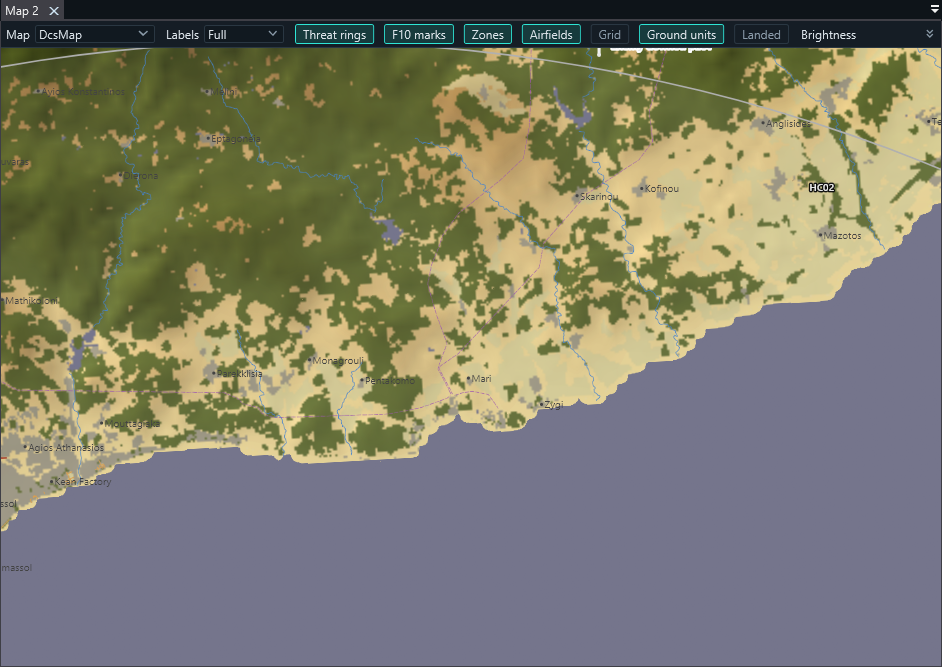
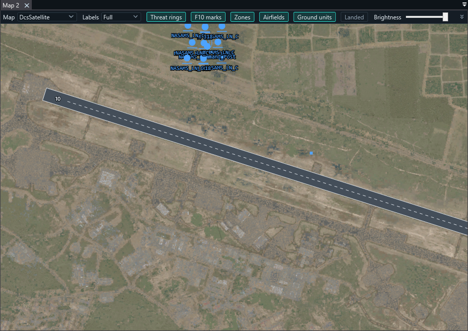

# Eagle's Nest

**An ATC / GCI controller station for DCS World multiplayer servers.**

Controllers connect from their own PC to a DCS server and get a live, fog-of-war picture of
their coalition: radar contacts, own flights, missiles, carriers and airfields. On top of that
come the tools to run the air war and the traffic around the bases: bullseye and BRAA calls,
RWR triangulation of SAM sites, airport diagrams, approach and carrier views, SRS radio
integration, and F10 map marks shared with the pilots.

> Working name. Inside the code, files and protocol the project is still called **DCB**
> (`dcb.dll`, `DCB-hook.lua`, `Config\DCB.lua`).

---

## Download

Get the latest release from the [Releases page](https://github.com/Bullat951/eagles-nest/releases):

| Package | For | What to do |
|---|---|---|
| `EaglesNest-Server-<version>.zip` | the DCS server admin | copy one folder, open one port, start the server |
| `EaglesNest-Client-<version>.zip` | each controller | unzip, start `Dcb.Client.exe` |

Pilots need nothing: they fly as usual and hear the controller on SRS.

---

## Features

**GCI scope**
- Per-coalition picture with fog of war: own units in full, enemy aircraft only when own radars see them.
- Speed vectors, data blocks, threat rings, missiles in flight (own, and enemy ones aimed at you).
- Bullseye call under the cursor, right-drag ruler with bearing / range / BRAA, coordinates in DDM, DMS, MGRS.
- Packages (four colour-coded groups), Foothold campaign zones, credits and mission board.

**RWR triangulation and F10 marks**
- A pilot's "spiked, 3 o'clock" becomes a bearing line on a radial clock; two or more lines give a fix with its error ellipse.
- Place a threat (SA-2 … SA-19, AAA, Patriot …) and its engagement ring appears for every controller.
- Threats go to the pilots as F10 map marks; any mark a pilot types that names a threat ("SA-11 near the dam") shows up as a ring too.
- Whether enemy ground units appear on radar at all depends on the mission's era (server setting).

| | |
|---|---|
|  |  |
| RWR bearing lines, fix and threat ring | DCS Map base map from the controller's own DCS install |

**ATC**
- Airport diagrams drawn from DCS data: runways, taxiway letters, stands, navaids, tower, in feet.
- 10 NM approach view with 3° path altitudes, ILS/TACAN, inbound sequence and profile.
- Runway queue per airfield and carrier; ATIS and airfield information sent to a pilot's screen.
- Carrier view (BRC, wind over deck, marshal stack) and LSO view with graded passes.

| | | |
|---|---|---|
|  |  |  |
| Airport diagram | 10 NM approach | Carrier and marshal |

**Maps and radio**
- Base maps: Scope, Satellite (online), DCS Map, DCS Charts and DCS Satellite (from your DCS install).
- SRS: tunes your own SRS client, gives SRS your position for range and line of sight, and listens to the SRS server to show who is on which frequency and who is talking.
- Several windows and screens, dark and light themes, layouts kept between sessions.

---

## Quick start

**Server admin** (details in `INSTALL.txt` inside the zip)
1. Stop the DCS server and copy the contents of `copy-into-saved-games` into its Saved Games folder.
2. Open TCP port 10309 for the controllers.
3. Start the server. The first start writes `Config\DCB.lua` with a random password per coalition: give each side its password.

**Controller** (details in `CLIENT.txt` inside the zip)
1. Install the [.NET 10 Desktop Runtime](https://dotnet.microsoft.com/download/dotnet/10.0) (x64) once.
2. Start `Dcb.Client.exe`. On the first start it finds your DCS World install and asks you to confirm it.
3. Connection → Connect: server address, port 10309, your coalition's password.

Then read the **[Operations manual](docs/MANUAL.md)**.

---

## Documentation

| | |
|---|---|
| [Operations manual](docs/MANUAL.md) | how to control with Eagle's Nest: maps, keys, GCI, triangulation, ATC, carrier, SRS |
| [Protocol](docs/PROTOCOL.md) | the server ↔ client messages and commands |
| [Analytics and website export](docs/ANALYTICS.md) | what the server records and exports |
| [Development](docs/DEVELOPMENT.md) | building, the test server, project layout, test tools |
| [Plan and history](docs/PLAN.md) | design decisions phase by phase |

---

## Security

The connection is plain TCP: passwords and the picture are not encrypted on the way. Limit the
firewall rule to your controllers' addresses or use a VPN (Tailscale, ZeroTier, WireGuard).
Controller actions on the server are a short fixed list, checked, rate-limited and logged.

## License

[MIT](LICENSE) © 2026 Bullat951. Third-party components and data: [THIRD-PARTY-NOTICES.md](THIRD-PARTY-NOTICES.md).
DCS World is a trademark of Eagle Dynamics SA; Eagle's Nest is an independent community project.
