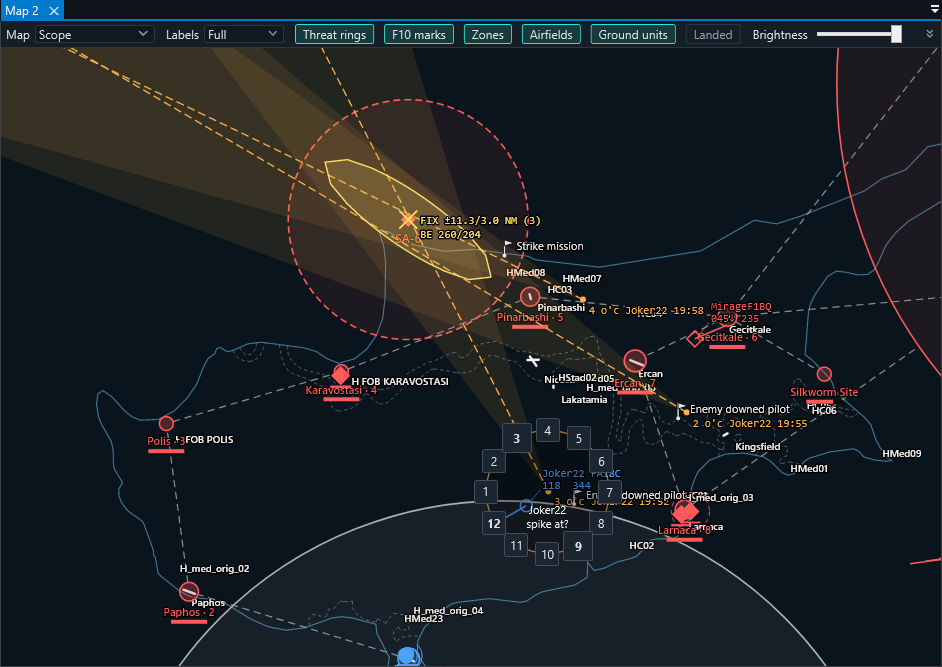

# Eagle's Nest — operations manual

For controllers (GCI and ATC). Server installation is in `INSTALL.txt` inside the server zip;
building from source is in [DEVELOPMENT.md](DEVELOPMENT.md).

- [1. First start and connecting](#1-first-start-and-connecting)
- [2. The workspace](#2-the-workspace)
- [3. Maps](#3-maps)
- [4. Keys and mouse](#4-keys-and-mouse)
- [5. GCI](#5-gci)
- [6. RWR triangulation and threats](#6-rwr-triangulation-and-threats)
- [7. F10 map marks](#7-f10-map-marks)
- [8. ATC](#8-atc)
- [9. Carrier and LSO](#9-carrier-and-lso)
- [10. SRS](#10-srs)
- [11. Several screens, themes, layout](#11-several-screens-themes-layout)
- [12. For the server admin](#12-for-the-server-admin)
- [13. Troubleshooting](#13-troubleshooting)

---

## 1. First start and connecting

1. Install the **.NET 10 Desktop Runtime (x64)** once from Microsoft.
2. Start `Dcb.Client.exe` (it can live in any folder).
3. **DCS World location.** The client looks for DCS by itself (ED installer, Steam, the usual
   folders on every disk) and shows what it found. Pick the right one and **Use this folder**,
   **Browse…** to another, or **Continue without DCS**. Without DCS everything works except the
   DCS base maps and the airfield details read from DCS. Change it later in
   *Window → Map data → DCS World folder…*.

   
4. **Connection → Connect…**: the server's address, port **10309** and your coalition's
   password (from the server admin). The password decides which side you control.
   Tick *Remember* to keep it (stored encrypted for your Windows user only). The SRS fields in
   the same dialog are optional (see [SRS](#10-srs)).

The status bar shows the connection, your coalition, the mission time and how many own units
and contacts you see.

## 2. The workspace

| Panel | What it is for |
|---|---|
| **Map** | the scope; open more with *Window → New map* |
| **Objects** | every unit you see, filterable (Air / Ground / Ships, Own / Contacts, Players only); click to select, double-click to centre |
| **Zones** | Foothold campaign zones, owners and strength (Foothold missions only) |
| **Packages** | four packages P1–P4: name, frequency, members |
| **ATC** | airfields and carriers, diagram, approach, carrier and LSO views, runway queue |
| **SRS** | your radios, who is on which frequency, who is talking |

Panels can be docked, tabbed, floated and moved to another screen.

## 3. Maps

The map toolbar picks the **base map** and what is drawn on it.

| Base map | Source | Notes |
|---|---|---|
| Scope | built in (Natural Earth coastlines and borders) | always available, fastest |
| Satellite | Esri World Imagery, online | needs internet |
| DCS Map | your DCS install | DCS's F10 look: relief, land cover, roads, MGRS grid. Drawn once in the background on first use (about 2 minutes per terrain), then instant |
| DCS Charts | your DCS install | ED's raster charts |
| DCS Satellite | your DCS install | DCS's own ground imagery, down to about 1 m per pixel |

Toggles: **Labels** (full / short / none), **Threat rings**, **F10 marks**, **Zones**,
**Airfields**, **Ground units**, **Landed** aircraft, and **Brightness** of the base map
(symbols stay bright). **Fit picture** zooms to everything you see.

## 4. Keys and mouse

| Input | Action |
|---|---|
| Left-drag | pan |
| Wheel | zoom |
| Click | select a track (or a Foothold zone) |
| **Right-drag** | ruler: magnetic bearing and range in NM; ending on an aircraft adds its altitude and aspect (BRAA) |
| Right-click | context menu of what is under the pointer (aircraft, threat, F10 mark, or the map) |
| Hold **B** | bullseye call of the pointer position |
| **R** | RWR clock for the aircraft under the pointer (or the selected one) |
| **Alt + click** | the point as DDM, DMS, decimal, MGRS, bullseye call and elevation, with Copy |
| Esc | closes the RWR clock or the point box |

The B and R keys can be changed in `%AppData%\DCB\settings.json` (`BullseyeKey`, `RwrKey`).

## 5. GCI

- **Own units** (blue for blue, red for red) carry callsign, type, altitude, speed. **Contacts**
  (enemy) appear only while your radars (AWACS, fighters, ships, ground radars) detect them;
  their type shows once identified. A lost contact fades out over 30 seconds.
- **Threat rings** around known enemy SAM sites; **missiles** in flight with a trail and a line
  to the target — yours always, enemy ones when fired at your units ("MSL").
- **Bullseye**: hold B over the map for "BE 247/38"; the ruler gives BRAA on any aircraft.
- **Packages**: right-click an own aircraft → *Add to package* P1–P4. Members get the package's
  colour and tag on every map; the Packages panel holds each package's name and frequency.
- **Messages to pilots**: right-click an own player's aircraft → *Send ATIS / airfield info*: the
  text appears on that pilot's screen (not in chat).
- **Foothold**: zones by owner with strength bars, links, logistics; the Zones panel lists them
  with credits and the mission board.

## 6. RWR triangulation and threats

Enemy SAMs usually do not show on the scope (they do only in missions dated 2012 or later, a
server setting). You find them with the pilots:

1. A pilot calls a spike, e.g. *"spiked, 3 o'clock"*.
2. Put the pointer on that aircraft (or select it) and press **R** — or right-click it →
   *RWR spike…*. A clock appears around the aircraft with **12 on its nose**; click the position
   the pilot called. A bearing line is drawn from where the aircraft is now, with a faint ±10°
   wedge for RWR error, labelled with the clock position, callsign and time.
3. Have the pilot turn or orbit and call again: each call adds a line. When two or more lines
   of the same aircraft cross, a **fix** appears: a yellow cross with its error ellipse
   (±major/minor in NM) and the bullseye call. More lines, wider angles → smaller ellipse.
4. Right-click the fix → **Place threat at fix** → the type (SA-2, SA-6, SA-11, AAA …). The
   threat's ring appears and that aircraft's lines are cleared. Anywhere else on the map:
   *Place threat here*.
5. Right-click the threat → **Send to F10 map** to give it to the pilots (see the next section),
   or **Coordinates…** to read it out on the radio (bullseye, DDM, MGRS, with Copy).

A threat not sent yet is your own note (only you see it); *Delete threat* removes it.
*Clear bearing lines* is on the aircraft's and the map's right-click menu.

## 7. F10 map marks

- **Send to F10 map** (a threat) or **Add F10 mark here…** (any text, right-click the map) puts
  a mark on your coalition's F10 map in the game. Pilots can delete or edit it there.
- **Marks are the live threats.** Every mark whose text starts with a threat type — sent from
  Eagle's Nest or typed by a pilot on the F10 map ("SA-11", "sa6 by the river") — is drawn as a
  threat with its ring on every controller's screen, also for a controller who connects later.
  When a pilot deletes the mark, the threat disappears from Eagle's Nest too.
- Other marks show as pins with their text: **green** from players (e.g. a downed pilot),
  **white** from the mission's scripts, **red** from Eagle's Nest. Foothold's zone labels are
  hidden. The **F10 marks** toolbar toggle hides them all.
- *Remove from F10 map* works on marks Eagle's Nest made; pilots' own marks are theirs to delete.

## 8. ATC

Pick an airfield (or carrier) in the ATC panel's list.

- **Diagram**: the airport drawn from DCS data — runways with headings, taxiway letters (from
  the signs DCS places), stand groups, tower, navaids, ILS, and an information block (tower
  frequencies, TACAN, runways in feet). Wheel to zoom, drag to pan, double-click for the whole
  field. Own traffic on the ground is shown live.

  
- **Approach (10 NM)**: the final approach of the chosen runway end with 3° path altitudes at
  2, 5 and 10 NM, the departure direction, ILS and TACAN, live traffic against the glidepath, the
  inbound sequence and a profile strip. Click the header for another runway end.

  
- **Runway queue** (right of the views): the order for the runway. Suggested arrivals and
  departures appear below; ▲▼ to move, priority, arrival/departure, ✕ to remove. Queued aircraft
  show "#n" on the scopes. It is your own planning board; pilots do not see it.
- **Set CH6**: tunes your SRS channel 6 to the airfield's tower frequency.
- **ATIS…** / **Airfield info…**: built from the server's live weather and the airfield,
  editable, sent as an on-screen text to a pilot.

## 9. Carrier and LSO

Pick a carrier in the ATC list.

- **Carrier**: base recovery course, wind over the deck (axial and crosswind), the case
  (I/II/III from the weather), the Case I pattern, beacons (TACAN, ICLS, Link 4, radio) and the
  **marshal stack**: who is inbound, at which angels and range. Wheel zooms 1–20 NM.
- **LSO**: aircraft in the groove against the glideslope and centreline (a fast 10 Hz feed from
  the server), with gear and hook, and a **pass log** with grades for each recovery.

## 10. SRS

Eagle's Nest works with the SRS client on your PC the way other controller tools do. Connect
your SRS client in **External AWACS Mode**.

- **Your radio position**: the ATC airfield or a fixed point, so SRS range and line of sight
  work for you; line-of-sight questions from SRS are answered from the terrain.
- **Tuning**: type a frequency or use the airfield's tower frequencies. Channel plan: CH6 = ATC,
  CH7–CH10 = packages P1–P4 (set from the Packages panel), CH1–5 free.
- **Listen**: Eagle's Nest can also join the SRS server itself, receive-only (others see
  "DCB (listen)"). It then lists your coalition's frequencies and who is on each, marks who is
  talking (in the list and with pulsing rings on the map), and right-clicking a player offers
  their radios to tune yours to. Enter the SRS port and your coalition's External AWACS Mode
  password in the Connect dialog.
- Coordinates and threats are read out by you on the radio: use *Coordinates…* for the text.

## 11. Several screens, themes, layout

- *Window → New window → GCI* or *ATC* opens another full window (e.g. for a second screen)
  sharing the connection and selection.
- *Window → ATC views* opens the Diagram, Approach, Carrier or LSO view as a panel of its own.
- *Window → Theme*: System, Dark or Light. The scopes stay dark and the airport diagram stays
  white.
- Windows, panels and map settings come back on the next start; *Window → Save layout* saves
  them now, *Window → Reset layout* restores the default.

## 12. For the server admin

- Settings are in `Config\DCB.lua` in the server's Saved Games folder: the two controller
  passwords, the port, and:
  - `enemy_ground = "auto"` (with `enemy_ground_year = 2012`): enemy ground units appear on
    radar only in missions dated that year or later; `true` / `false` to force it.
  - `analytics`, `export`: local files for statistics and a website (see
    [ANALYTICS.md](ANALYTICS.md)). Nothing is sent anywhere.
- Everything Eagle's Nest does on the server is logged in `Logs\dcs.log` under "DCB": logins,
  every controller command (text to a pilot, F10 marks) and refusals.
- Cost: well under 1 % of one CPU core, about 22 MB of memory, and 15–40 KB/s per connected
  controller after a one-off 12 MB download on login.

## 13. Troubleshooting

| Problem | Check |
|---|---|
| "Wrong password" | the password decides the coalition; ask the admin which one is yours |
| Cannot connect | server address and port 10309, the server's firewall, the server actually running a mission |
| No DCS Map / Charts / Satellite in the list or they stay empty | *Window → Map data → DCS World folder…*; the terrain must be installed in your DCS |
| DCS Map slow the first time | it is drawn once per terrain in the background (about 2 minutes), then instant |
| No enemy SAMs on the scope | normal for missions before 2012: triangulate them (section 6) |
| Nothing in the SRS tab | SRS client running and connected in External AWACS Mode |
| Anything else | `%LocalAppData%\DCB\render-errors.log` (client), the server's `dcs.log` (search "DCB") |
